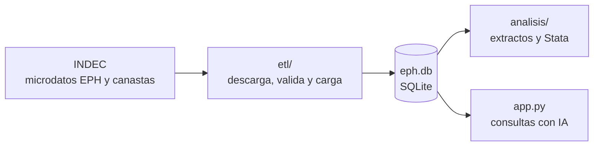
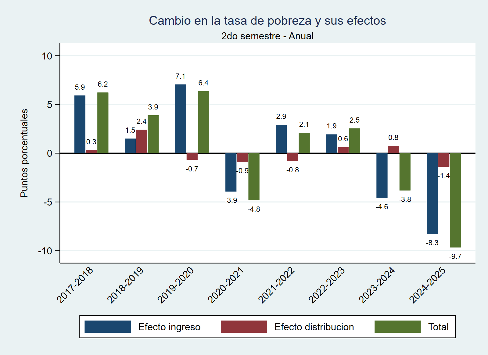
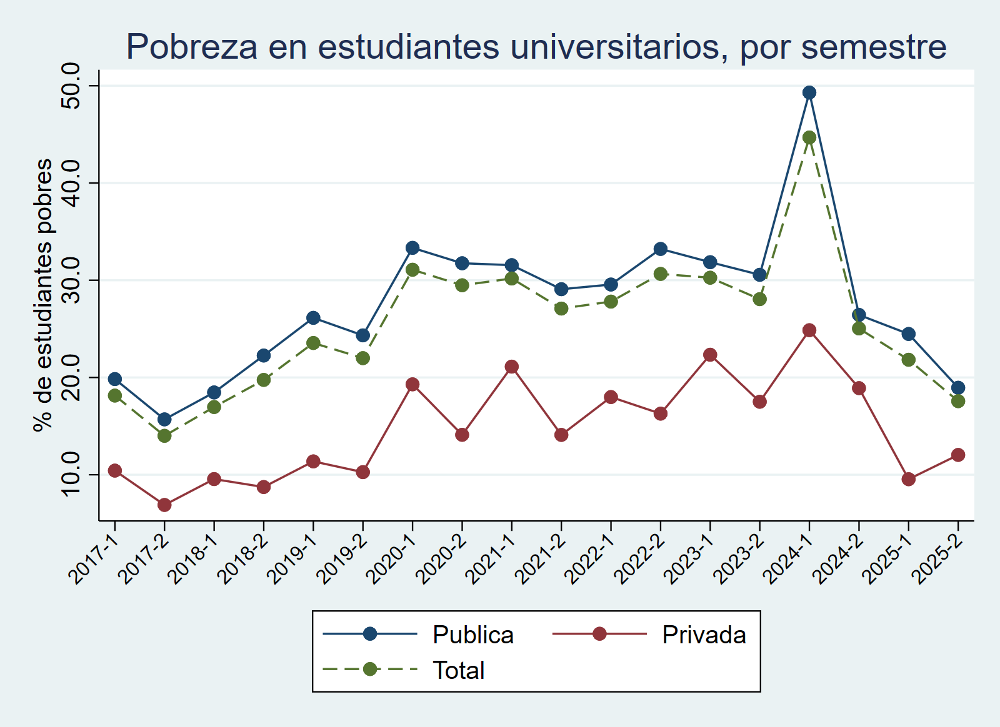

# 📊 Microdatos de la EPH: de los archivos del INDEC al análisis

**Un flujo completo para trabajar con la Encuesta Permanente de Hogares (EPH, INDEC): construye una base de datos única a partir de las fuentes públicas y luego analízala por tu cuenta o delégale las consultas a una IA.**

[](https://eph-llm-explorer.streamlit.app/)

Prueba el asistente de IA en vivo aquí: **[EPH AI Explorer](https://eph-llm-explorer.streamlit.app/)**

## 🎯 Sobre el Proyecto

Los microdatos de la EPH se publican en decenas de archivos separados, con formatos y nombres que cambian de un período a otro. Antes de analizar nada hay que descargarlos, ordenarlos y unirlos. Este repositorio resuelve todo el recorrido, de punta a punta:

1. **Construir la base.** Un pipeline ETL descarga, valida y une los datos del INDEC (2016-2025, ~2 millones de registros) en una base SQLite lista para consultar, con un solo comando.
2. **Analizarla**, por cualquiera de dos caminos sobre la misma base:
   - **A mano**, con tus propias herramientas (Python, Stata, SQL). Hay dos análisis de ejemplo.
   - **Delegando a una IA**: una aplicación traduce preguntas en español a SQL, ejecuta la consulta y grafica el resultado.



## 🧩 Estructura del Repositorio

```
eph-llm-explorer/
├── etl/                           # 1. Construir la base
│   ├── README.md                  #    documentación técnica del pipeline
│   ├── eph_sql.py
│   └── EPH diseño.pdf
├── analisis/                      # 2a. Analizar por tu cuenta (ejemplos)
│   ├── descomposicion_pobreza/
│   └── pobreza_universitaria/
├── app.py                         # 2b. Analizar con IA (Streamlit)
├── requirements.txt
└── LICENSE
```

| Etapa | Carpeta | Qué hace |
|---|---|---|
| 1. Construir la base | [`etl/`](etl/) | Descarga la EPH y las canastas de pobreza, verifica lo que carga y arma `eph.db`. Es incremental: solo incorpora lo que falta. [Ver detalle técnico](etl/README.md) |
| 2a. Análisis propio | [`analisis/`](analisis/) | Extrae de la base solo lo necesario y lo analiza en Stata. Incluye dos ejemplos completos |
| 2b. Análisis con IA | [`app.py`](app.py) | Consultas en lenguaje natural sobre la base, con gráficos automáticos |

## 1. Construir la base

```bash
cd etl
python eph_sql.py cargar      # descarga microdatos + canastas y arma eph.db
python eph_sql.py pobreza     # imprime pobreza e indigencia por semestre
```

El proceso procesa un trimestre a la vez, valida las canastas contra valores de control y termina con un aviso claro si algo falla. La documentación completa (cómo funciona, variables, configuración y limitaciones) está en el [README del pipeline](etl/README.md).

## 2a. Analizar por tu cuenta

Con la base lista, cada análisis genera un extracto con solo las variables necesarias y lo procesa en Stata. La carpeta [`analisis/`](analisis/) incluye dos ejemplos que parten de la misma base.

### ¿Por qué cambió la pobreza?

Separa el cambio de un año a otro en dos causas: que **cambió el nivel de ingresos** de los hogares, o que **cambió cómo se reparten** esos ingresos. También incluye comparaciones entre períodos y escenarios hipotéticos.

<p align="center">
  
</p>

Código: [`analisis/descomposicion_pobreza/`](analisis/descomposicion_pobreza/)

### Pobreza en estudiantes universitarios

Compara qué proporción de estudiantes universitarios vive en hogares pobres según estudien en universidad **pública o privada**, cómo trabajan y cómo se distribuyen por nivel de ingresos.

<p align="center">
  
</p>

Código: [`analisis/pobreza_universitaria/`](analisis/pobreza_universitaria/)

> Son estimaciones propias con la metodología del INDEC, a partir de una encuesta por muestreo. Las limitaciones están detalladas en el [README del pipeline](etl/README.md#notas-metodológicas-y-limitaciones).

## 2b. Delegar el análisis a una IA: EPH AI Explorer

EPH AI Explorer es una interfaz interactiva que democratiza el acceso a los microdatos. A diferencia de los dashboards tradicionales —que limitan al usuario a filtros y gráficos predefinidos—, integra Inteligencia Artificial (Google Gemini) para traducir preguntas de negocio en lenguaje natural a código SQL estructurado. El resultado es una plataforma de análisis *ad-hoc* donde se puede explorar la base, extraer insights y generar visualizaciones de forma dinámica.

*   **Consultas Dinámicas (Text-to-SQL):** Permite a usuarios sin conocimientos técnicos interrogar una base de datos compleja (millones de registros) escribiendo sus preguntas en español.
*   **Visualización Automática (Plotly):** Dependiendo de la estructura de la consulta generada, la aplicación interpreta los resultados y renderiza gráficos interactivos para facilitar la comprensión de las tendencias.
*   **Rigor Metodológico Integrado:** El modelo está condicionado por un diccionario semántico estricto para aplicar correctamente los ponderadores poblacionales y las líneas de pobreza oficiales, asegurando que las inferencias estadísticas sean válidas.
*   **Arquitectura Desacoplada y Escalable:** La aplicación consulta la base que construye el pipeline de este repositorio. Gracias a su diseño modular, con un pequeño cambio en el código, el sistema puede modificarse fácilmente para realizar consultas sobre cualquier otra base de datos o conectarse a otros modelos de inteligencia artificial.

## 🚀 Instalación y Uso Local

1. **Clonar el repositorio e instalar dependencias:**
   ```bash
   git clone https://github.com/Marco-D-Sosa/eph-llm-explorer.git
   cd eph-llm-explorer
   pip install -r requirements.txt
   ```

2. **Elegir cómo seguir:**

   **Solo quiero probar la aplicación.** Configura la API Key: crea una carpeta oculta `.streamlit` en la raíz del proyecto y, dentro, un archivo `secrets.toml` con tu clave de Google AI Studio:
   ```toml
   GEMINI_API_KEY = "tu_clave_api_aqui"
   ```
   Luego ejecuta:
   ```bash
   streamlit run app.py
   ```
   La primera vez, la aplicación descarga la base (~200 MB) desde el release `v1.0` del repositorio y la guarda como `eph.db` en la carpeta desde la que se ejecuta.

   **Quiero armar el flujo completo desde las fuentes del INDEC.** Construye la base con el pipeline (ver [README del ETL](etl/README.md)):
   ```bash
   cd etl
   python eph_sql.py cargar
   ```
   La base queda en `etl/eph.db`. A partir de ahí, puedes correr los análisis de [`analisis/`](analisis/) o copiar `etl/eph.db` a la raíz del repositorio como `eph.db` para que la aplicación la use en lugar de descargar la publicada.

## 🛠️ Stack Tecnológico

*   **Lenguaje:** Python
*   **Base de datos:** SQLite
*   **Pipeline ETL:** Python (Pandas) y SQL (vistas)
*   **Análisis de ejemplo:** Python (extractos de datos) y Stata (resultados y gráficos)
*   **Interfaz de Usuario:** Streamlit
*   **Visualización:** Plotly Express
*   **Integración IA:** SDK Nativo de Google Generative AI (Modelos familia Gemini Flash)

## 📄 Fuente de los Datos y Licencia

Fuente de los datos: INDEC (Encuesta Permanente de Hogares y canastas de pobreza), [www.indec.gob.ar](https://www.indec.gob.ar). Código bajo licencia MIT.
